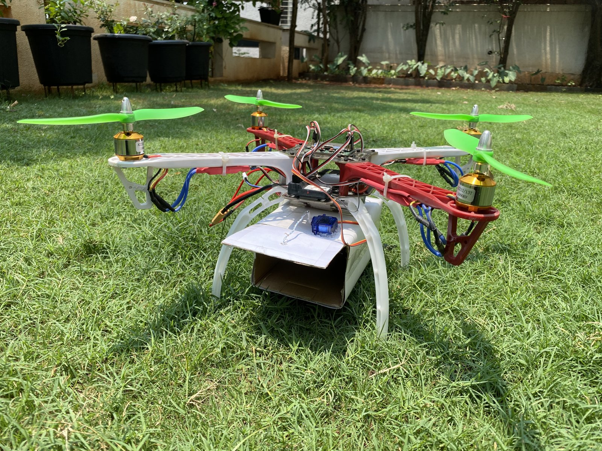
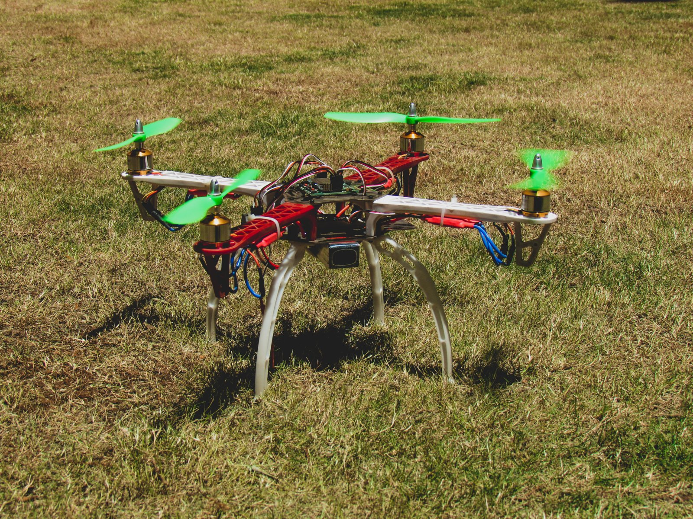

# Delivery-Quadcopter

A radio controlled quadcopter that carries a small box and drops it with a servo. Built as a college group project (E&TC, SIT Pune) in March-April 2021.

There is no code in this repo. The flight controller is a KK2.1 board, which comes with its own firmware and is set up from its LCD menus. The servo for the box runs straight off a spare receiver channel.

## Parts

| Part | Qty |
|------|-----|
| F450 quadcopter frame kit | 1 |
| KK2.1 multirotor flight control board (LCD) | 1 |
| A2212 1000KV brushless motor | 4 |
| 30A 2-3S brushless ESC | 4 |
| 8x4.5 propellers (CW + CCW pair) | 2 pairs |
| FlySky 6 channel transmitter and receiver | 1 |
| LiPo battery | 1 |
| SG90 micro servo | 1 |
| Cardboard box for the payload | 1 |

The parts (without the servo and box) came to about Rs 9250.

## How it works

- The LiPo powers all four ESCs in parallel. Each ESC drives one brushless motor based on the signal from the KK2.1 on M1-M4.
- The transmitter sends the stick positions to the receiver. Throttle, elevator, aileron and rudder go from the receiver into the KK2.1, which uses its gyro and accelerometer to keep the quad level and mixes the sticks into the four motor outputs.
- Two props spin clockwise and two anti-clockwise so the quad doesn't spin on its own.
- One of the leftover receiver channels drives the servo. Moving that channel on the transmitter makes the servo open the box so the package drops out.

Wiring, the KK2.1 setup order and the problems we hit are in [docs/setup.md](docs/setup.md).

## Files

- `Delivery_Quadcopter.pdf` - project presentation (block diagram, working, plan of work, costing, results)
- `Final Video.mp4` - flight video
- `images/` - photos of the finished build

